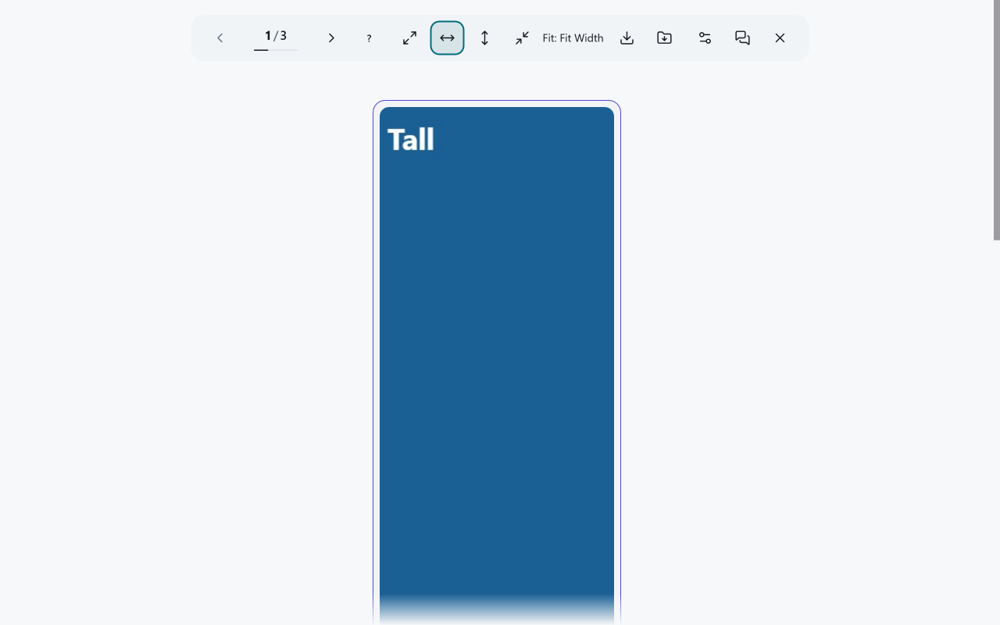
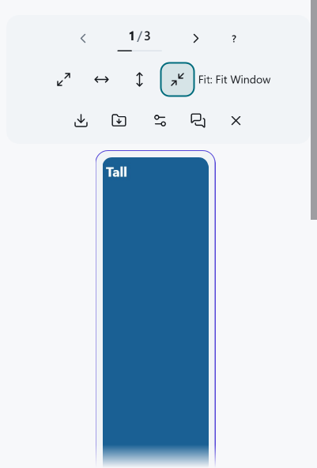

# X.com Enhanced Gallery

[English](./README.md) | [한국어](./README.ko.md) | [日本語](./README.ja.md)

X.com の投稿にある画像や動画を、キーボードでも操作しやすいギャラリーで
閲覧し、対応するメディアを確認できた品質で保存できます。デスクトップ
ブラウザー向けです。

## インストール方法を選ぶ

| 配布方法 | 再起動後も使えますか | 更新方法 | 必要なもの |
| --- | --- | --- | --- |
| [ユーザースクリプト](#ユーザースクリプト) | はい。ユーザースクリプトマネージャーで保持します。 | マネージャーが更新を提示したら、内容を確認して承認します。 | 対応するデスクトップブラウザーとユーザースクリプトマネージャー |
| [Chrome・Edge・Brave 拡張機能](#chromeedgebrave-拡張機能) | はい。展開先のディレクトリと拡張機能を保持している間は使えます。 | 展開済みファイルを手動で入れ替え、拡張機能を再読み込みします。 | デベロッパーモードと保持するディレクトリ |
| [Firefox 拡張機能](#firefox-拡張機能) | いいえ。ブラウザーの再起動時に一時アドオンは削除されます。 | 新しい ZIP を各セッションで手動で読み込みます。 | Firefox 128+ と `about:debugging` |

以下のアーカイブは GitHub リリースの開発者向けビルドであり、公開ブラウザー
ストアでのインストールではありません。バージョン条件は
[ブラウザー対応](#ブラウザー対応)を確認してください。

## クイックスタート

1. 対応する画像や動画を含む X.com の投稿を開きます。画像または
   ギャラリーを開ける動画領域を選びます。動画のクリックは保存済みの
   [動画クリックモード](./docs/video-click-policy.md)に従い、X の再生
   コントロールは元の動作を続ける場合があります。
2. ツールバーの前へ・次へ、矢印キー、ホイールで表示項目を移動します。
   未公開の開発ビルドでは、ツールバーのキーボードヘルプ（?）ボタン、
   または `?` でデスクトップのキー操作一覧を開けます。
3. ツールバーで表示のフィットモードを選びます。表示だけが変わり、
   [保存元や品質](./docs/media-sources.md)は変わりません。
4. ダウンロードで現在表示中の項目を保存するか、表示中の項目を ZIP で
   保存します。ブラウザーへの保存依頼は、ディスクへの保存完了を証明
   しません。ZIP に欠落項目がある場合は結果を確認し、欠落項目の復旧が
   表示されたときだけ利用します。追加の ZIP を受け取っても、先の ZIP は
   保管してください。[ダウンロードの制限](#ダウンロードの制限)も確認してください。
5. 閉じる、または Escape でギャラリーを閉じて X の投稿に戻ります。
   ツールバー内にフォーカスがある場合、Escape は開いている設定または
   キーボードヘルプを先に閉じます。元の投稿へのリンクが表示される場合は、
   その投稿を別に開けます。

*未公開の開発ビルドです。制御されたテスト用メディアを用いた、インストール済み Edge
拡張機能の画面です。画面サイズ 1280 × 800、タブのズーム 100%、システム DPI
200%。[撮影情報](./docs/images/README.md)。*

*未公開の開発ビルドです。制御されたテスト用メディアを用いた、インストール済み Edge
拡張機能の画面です。画面サイズ 401 × 592、タブのズーム 100%、システム DPI
200%。[撮影情報](./docs/images/README.md)。*

ギャラリーの動画は、別のプレーヤーで最初から一時停止した状態で開き、
ギャラリーに保存された音量・ミュート設定を使います。ギャラリーを閉じても
X 側の再生は自動では再開しません。
[動画クリックと元の再生に関する方針](./docs/video-click-policy.md)を参照してください。

## 機能

- 画像、動画、GIF、対応するカードメディアの縦型ギャラリー
- 確認できた CDN 原寸写真と対応メディアの個別・ZIP ダウンロード
- デスクトップブラウザーでのキーボード、ポインター、ホイール操作
- オリジナル、幅、高さ、コンテナーに合わせる画像表示モード
- テーマ、言語、再生、ギャラリー設定の保存
- プロジェクトによる解析、テレメトリー、開発者運営サーバーなし

## インストール

### ユーザースクリプト

[Tampermonkey](https://www.tampermonkey.net/) または
[Violentmonkey](https://violentmonkey.github.io/) などのユーザースクリプト
マネージャーを導入し、マネージャーで
[最新のユーザースクリプト](https://github.com/PiesP/xcom-enhanced-gallery/releases/latest/download/xcom-enhanced-gallery.user.js)を
インストールします。内容を確認して承認してください。マネージャーはヘッダーの
メタデータ URL から更新を確認できます。更新が提示された場合も、内容を
確認して承認してください。以前のインストールが特定バージョンの URL を
取得し続ける場合は[一度だけ必要な修復](#以前のバージョンに固定されたユーザースクリプト)を
参照してください。

### Chrome、Edge、Brave 拡張機能

[最新リリース](https://github.com/PiesP/xcom-enhanced-gallery/releases/latest)の
`xcom-enhanced-gallery-chrome.zip` は展開して使う開発者向けビルドです。
自動更新はされません。

1. アーカイブをダウンロードし、保持するディレクトリへ展開します。
2. `chrome://extensions` を開き、**デベロッパー モード**を有効にします。
3. **パッケージ化されていない拡張機能を読み込む**を選び、展開先を指定します。

後のリリースに更新するときは同じディレクトリのファイルを入れ替え、
`chrome://extensions` で拡張機能を再読み込みしてください。更新後は保存済みの
設定を確認してください。

### Firefox 拡張機能

1. [最新リリース](https://github.com/PiesP/xcom-enhanced-gallery/releases/latest)の
   `xcom-enhanced-gallery-firefox.zip` をダウンロードします。
2. `about:debugging#/runtime/this-firefox` を開きます。
3. **一時的なアドオンを読み込む**で ZIP を選びます。

Firefox を再起動すると、この開発者向けの一時インストールは削除されます。
次のセッションでは再び読み込むか、継続利用には対応するユーザースクリプト
マネージャーを使ってください。

## 問題解決と制限

### 以前のバージョンに固定されたユーザースクリプト

インストール済みスクリプトの `@downloadURL` が特定のバージョンを指して
いると、新しい版を検出しても古いスクリプトを再取得する場合があります。
修正版の公開後、マネージャーで既存のスクリプトを
[最新のユーザースクリプト](https://github.com/PiesP/xcom-enhanced-gallery/releases/latest/download/xcom-enhanced-gallery.user.js)から
一度更新するか、確認済みのマネージャーの手順でダウンロード URL を変更して
ください。**更新の確認**だけでは固定された URL は修正されません。更新後は
ヘッダーと保存済みの設定を確認してください。

### 一部のメディアと保存元

投稿のメディアを取得できない場合、投稿へのリンクで所有者を確認できる
タイルから、表示中でアクセス可能なメディアだけを復元することがあります。
案内はその制限を示し、ZIP には表示中の項目だけが入ります。投稿のすべての
添付メディアとは限りません。CDN の原寸写真は、投稿者がアップロードした
ファイルとバイト単位で同じとは限りません。原寸画像を確認できない場合、
小さい画像へ黙って切り替えて保存しません。復元した動画は観測できた保存元に
限られ、別のソースで再生できても保存元は変わりません。HLS のみの添付には
対応する MP4 ソースが必要です。[メディアソース](./docs/media-sources.md)、
[動画の読み込み](./docs/media-video-loading.md)、
[API の取得と失敗](./docs/twitter-api-contract.md)を参照してください。

### ダウンロードの制限

Blob と ZIP のダウンロードはページ内のメモリ上限を共有します。拡張機能の
単一ファイル保存はブラウザーのダウンロードマネージャーを使い、ファイル全体の
ページ Blob は予約しません。上限に達したら、実行中のダウンロードが終わるまで
待ってください。実行中のものがなくても上限に達する場合はページを再読み込みし、
一度に保存するファイル数を減らしてください。ブラウザー管理の保存が完了する
前に再読み込みしないでください。不明な保存結果から完了や安全な重複保存は
推定できません。ユーザースクリプトによる保存はページを閉じるか再読み込み
するまでメモリ枠を保持する場合があり、ギャラリーを開き直しても返りません。
一部の項目だけが入った ZIP の結果には、含まれた項目・除外された項目の
範囲と失敗理由が表示されます。
[ダウンロードの所有権と復旧](./docs/download-memory.md)および
[ZIP 入力の規則](./docs/zip-input-admission.md)を参照してください。

ギャラリーはモバイルやタッチ操作の流れには対応していません。

## ブラウザー対応

| 配布方法 | 対応範囲 |
| --- | --- |
| ユーザースクリプト | Chrome/Edge 123+, Firefox 128+, Safari 17.5+ |
| Chromium 拡張機能 | 現行のデスクトップ版 Chrome、Edge、Brave のデベロッパー モード |
| Firefox 拡張機能 | Firefox 128+ の一時的な開発者向けインストール |

ユーザースクリプトの最低対応バージョンは、
[`tooling/vite/browser-support.ts`](./tooling/vite/browser-support.ts) の
`USERSCRIPT_BROWSER_SUPPORT` で定義されています。Firefox 拡張機能の最低
バージョンは、
[`extension/manifest.firefox.json`](./extension/manifest.firefox.json) で定義
されています。

## プライバシーとセキュリティ

ギャラリーと保存機能のために、投稿内容、投稿者の識別情報、ページ・メディアの
URL、X のセッション認証情報を処理します。設定と拡張機能のダウンロード復旧
記録はローカルに保存され、開発者運営サーバーや解析サービスはありません。
機能に必要なリクエストは X/Twitter とメディア提供元に送信され、リダイレクトの
処理はブラウザーやマネージャーの通信方式によって異なります。送信先、保存と
削除方法は [プライバシー](./PRIVACY.md)、脆弱性の報告方法は
[セキュリティポリシー](./.github/SECURITY.md)を参照してください。

## 開発

このプロジェクトは AI ツールの支援を受けて開発されています。

セットアップ、コマンド、プロジェクトの制約、プルリクエストの要件は
[コントリビューションガイド](./CONTRIBUTING.md)を参照してください。

## サポート

- バグ、機能要望、質問: [GitHub Issues](https://github.com/PiesP/xcom-enhanced-gallery/issues)
- リリース履歴: [変更履歴](./CHANGELOG.md)
- 脆弱性: [セキュリティポリシー](./.github/SECURITY.md)

## ライセンス

MIT。[LICENSE](./LICENSE)、[NOTICE](./NOTICE.md)、同梱の
[サードパーティライセンス](./LICENSES/)を参照してください。
