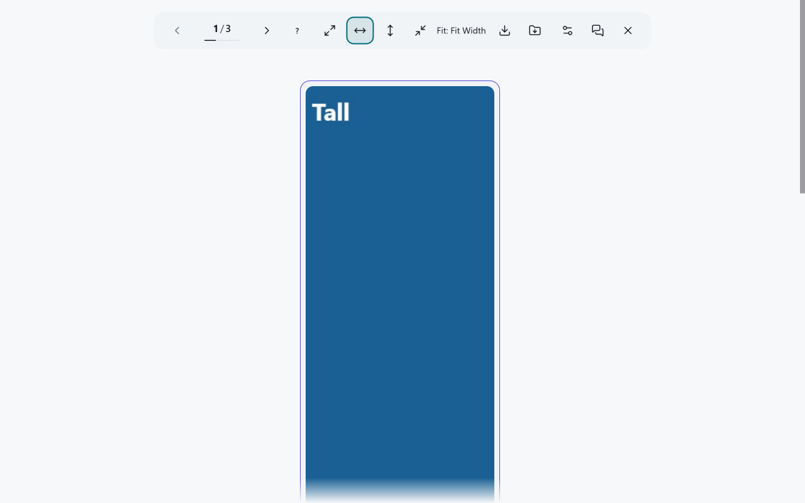
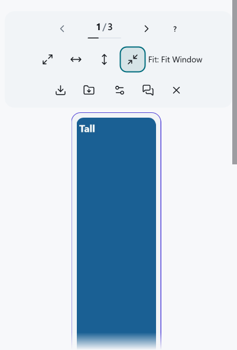

# X.com Enhanced Gallery

[English](./README.md) | [한국어](./README.ko.md) | [日本語](./README.ja.md)

X.com 게시물의 이미지와 동영상을 키보드로 탐색하기 쉬운 전용 갤러리에서 보고,
지원되는 미디어를 확인된 품질로 저장할 수 있습니다. 데스크톱 브라우저용입니다.

## 설치 방식 선택

| 배포 방식 | 브라우저 재시작 후에도 유지되나요? | 업데이트 방법 | 준비할 것 |
| --- | --- | --- | --- |
| [사용자 스크립트](#사용자-스크립트) | 예. 사용자 스크립트 관리자에서 유지합니다. | 관리자가 업데이트를 제시할 수 있으며, 내용을 확인하고 승인해야 합니다. | 지원되는 데스크톱 브라우저와 사용자 스크립트 관리자 |
| [Chrome·Edge·Brave 확장 프로그램](#chrome-edge-또는-brave-확장-프로그램) | 예. 압축을 푼 디렉터리와 확장 프로그램을 유지하는 동안 설치됩니다. | 파일을 직접 교체하고 확장 프로그램을 다시 로드합니다. | 개발자 모드와 계속 보관할 디렉터리 |
| [Firefox 확장 프로그램](#firefox-확장-프로그램) | 아니요. 브라우저를 다시 시작하면 임시 부가 기능이 제거됩니다. | 새 ZIP을 각 세션에서 직접 로드합니다. | Firefox 128+와 `about:debugging` |

아래 압축 파일은 GitHub 릴리스의 개발자용 빌드이며 공개 브라우저 스토어 설치
경로가 아닙니다. 버전 요건은 [브라우저 지원](#브라우저-지원)을 확인하세요.

## 빠른 사용법

1. 지원되는 이미지나 동영상이 포함된 X.com 게시물을 엽니다. 이미지를
   누르거나 갤러리를 열 수 있는 동영상 영역을 선택합니다. 동영상 클릭은 저장된
   [동영상 클릭 모드](./docs/video-click-policy.md)를 따르며, X의 재생 컨트롤은
   원래 동작을 유지할 수 있습니다.
2. 도구 모음의 이전·다음 버튼, 화살표 키 또는 휠로 표시된 항목을 이동합니다.
   아직 공개되지 않은 개발 빌드에서는 도구 모음의 키보드 도움말(?) 버튼이나 `?`로
   데스크톱 단축키 전체 목록을 볼 수 있습니다.
3. 도구 모음에서 표시 모드를 선택합니다. 이 설정은 화면 표시만 바꾸며
   [저장 소스나 품질](./docs/media-sources.md)은 바꾸지 않습니다.
4. 다운로드 버튼으로 현재 표시된 항목을 저장하거나, 표시된 항목들을 ZIP으로
   저장합니다. 브라우저에 저장 요청을 넘겼다는 사실만으로 디스크 저장 완료가
   확인되지는 않습니다. ZIP에서 일부 항목이 빠졌다면 결과를 확인하고, 누락
   항목 복구가 제시될 때만 사용하세요. 추가 ZIP을 받아도 앞서 받은 ZIP을
   보관하세요. [다운로드 제한](#다운로드-제한)도 참고하세요.
5. 닫기 또는 Escape로 갤러리를 닫고 X 게시물로 돌아갑니다. 도구 모음에
   초점이 있으면 Escape는 열린 설정이나 키보드 도움말을 먼저 닫습니다.
   원본 게시물 링크가 표시되면 별도로 해당 게시물을 열 수 있습니다.

*미공개 개발 빌드: 제어된 미디어를 사용한 설치형 Edge 확장 프로그램입니다.
화면 크기 1280 × 800, 탭 확대 100%, 시스템 DPI 200%.
[캡처 정보](./docs/images/README.md).*

*미공개 개발 빌드: 제어된 미디어를 사용한 설치형 Edge 확장 프로그램입니다.
화면 크기 401 × 592, 탭 확대 100%, 시스템 DPI 200%.
[캡처 정보](./docs/images/README.md).*

갤러리의 동영상은 별도의 플레이어에서 일시정지된 상태로 처음부터 열리며,
갤러리에 저장된 음량·음소거 설정을 사용합니다. 갤러리를 닫아도 X의 재생이
자동으로 이어지지 않습니다. [동영상 클릭 및 기본 재생 정책](./docs/video-click-policy.md)을
참고하세요.

## 기능

- 이미지, 동영상, GIF 및 지원되는 카드 미디어를 위한 세로 갤러리
- 확인된 CDN 원본 크기 사진과 지원 미디어의 개별·일괄 ZIP 다운로드
- 데스크톱 브라우저에서 키보드, 포인터 및 휠 탐색
- 원본, 너비, 높이 및 컨테이너 맞춤 이미지 표시 모드
- 테마, 언어, 재생 및 갤러리 설정 저장
- 프로젝트 자체 분석, 원격 측정 또는 개발자 운영 서버 없음

## 설치

### 사용자 스크립트

[Tampermonkey](https://www.tampermonkey.net/) 또는
[Violentmonkey](https://violentmonkey.github.io/) 같은 사용자 스크립트 관리자를
설치하고, 관리자에서 [최신 사용자 스크립트](https://github.com/PiesP/xcom-enhanced-gallery/releases/latest/download/xcom-enhanced-gallery.user.js)를
설치합니다. 설치 내용을 확인하고 승인하세요. 관리자는 스크립트 헤더의
메타데이터 URL로 업데이트를 확인할 수 있습니다. 업데이트가 제시되면 관리자
화면에서 내용을 확인하고 승인하세요. 이전 설치본에서 특정 버전의 URL을
계속 받는다면 [한 번만 필요한 복구](#이전-버전에-고정된-사용자-스크립트)를
참고하세요.

### Chrome, Edge 또는 Brave 확장 프로그램

[최신 릴리스](https://github.com/PiesP/xcom-enhanced-gallery/releases/latest)의
`xcom-enhanced-gallery-chrome.zip`은 압축을 풀어 사용하는 개발자용 빌드로,
자동 업데이트되지 않습니다.

1. 압축 파일을 다운로드하고 계속 보관할 디렉터리에 풉니다.
2. `chrome://extensions`를 열고 **개발자 모드**를 켭니다.
3. **압축해제된 확장 프로그램을 로드합니다**를 선택해 압축을 푼
   디렉터리를 지정합니다.

새 버전으로 바꿀 때는 같은 디렉터리의 파일을 교체하고
`chrome://extensions`에서 확장 프로그램을 다시 로드하세요. 업데이트 후
저장된 설정을 확인하세요.

### Firefox 확장 프로그램

1. [최신 릴리스](https://github.com/PiesP/xcom-enhanced-gallery/releases/latest)의
   `xcom-enhanced-gallery-firefox.zip`을 다운로드합니다.
2. `about:debugging#/runtime/this-firefox`를 엽니다.
3. **임시 부가 기능 로드**를 선택해 ZIP을 지정합니다.

Firefox를 다시 시작하면 이 개발자용 임시 설치가 제거됩니다. 다음 세션에서
다시 로드하거나, 계속 설치해 두려면 지원되는 사용자 스크립트 관리자를
사용하세요.

## 문제 해결과 제한 사항

### 이전 버전에 고정된 사용자 스크립트

설치된 스크립트의 `@downloadURL`이 특정 버전으로 고정되어 있으면 새 버전을
찾아도 이전 스크립트를 다시 받을 수 있습니다. 수정된 버전이 공개된 뒤에는
관리자에서 기존 스크립트를 [최신 사용자 스크립트](https://github.com/PiesP/xcom-enhanced-gallery/releases/latest/download/xcom-enhanced-gallery.user.js)로
한 번 업데이트하거나, 확인된 관리자 절차에 따라 다운로드 URL을 바꾸세요.
**업데이트 확인**만으로는 고정된 URL이 바뀌지 않습니다. 업데이트 후 설치된
헤더와 저장된 설정을 확인하세요.

### 일부 미디어와 저장 소스

게시물 미디어를 추출할 수 없으면 게시물 링크로 소유자가 확인된 타일에서
보이고 접근 가능한 미디어만 복구할 수 있습니다. 안내가 이 제한된 범위를
알리며 ZIP에는 표시된 항목만 담깁니다. 게시물의 모든 첨부파일이 아닐 수
있습니다. CDN의 원본 크기 사진은 업로더 파일과 바이트가 같다는 뜻이
아닙니다. 원본 사진을 확인할 수 없으면 더 작은 사진을 몰래 저장하지 않습니다.
복구한 동영상은 관찰된 저장 소스만 사용할 수 있으며, 다른 소스로 재생하더라도
저장 소스는 바뀌지 않습니다. HLS만 있는 항목에는 지원되는 MP4 소스가
필요합니다. [미디어 소스](./docs/media-sources.md),
[동영상 로딩](./docs/media-video-loading.md),
[API 획득과 실패](./docs/twitter-api-contract.md)를 참고하세요.

### 다운로드 제한

Blob과 ZIP 다운로드는 페이지 안의 메모리 한도를 공유합니다. 확장 프로그램의
개별 파일 저장은 브라우저 다운로드 관리자를 사용하며 파일 전체 크기의
페이지 Blob을 예약하지 않습니다. 한도에 도달하면 진행 중인 다운로드가
끝날 때까지 기다리세요. 진행 중인 다운로드가 없는데도 한도에 걸리면
페이지를 새로고침하고 한 번에 더 적은 파일을 받아 보세요. 브라우저가
관리하는 저장이 끝나기 전에 새로고침하지 마세요. 결과가 불확실한 저장
요청은 완료 증거나 중복 저장의 안전성을 뜻하지 않습니다. 사용자 스크립트의
메모리 점유는 페이지를 닫거나 새로고침할 때까지 남을 수 있고, 갤러리를
다시 열어도 반환되지 않습니다. 일부만 담긴 ZIP 결과에는 포함·제외 범위와
실패 이유가 표시됩니다. [다운로드 소유권 및 복구 규칙](./docs/download-memory.md)과
[ZIP 입력 규칙](./docs/zip-input-admission.md)을 참고하세요.

갤러리는 모바일이나 터치 조작 흐름을 제공하지 않습니다.

## 브라우저 지원

| 배포 방식 | 지원 범위 |
| --- | --- |
| 사용자 스크립트 | Chrome/Edge 123+, Firefox 128+, Safari 17.5+ |
| Chromium 확장 프로그램 | 최신 데스크톱 Chrome, Edge 및 Brave의 개발자 모드 |
| Firefox 확장 프로그램 | Firefox 128+ 임시 개발자 설치 |

사용자 스크립트의 최소 호환 버전은
[`tooling/vite/browser-support.ts`](./tooling/vite/browser-support.ts)의
`USERSCRIPT_BROWSER_SUPPORT`에서 정의합니다. Firefox 확장 프로그램의 최소
버전은 [`extension/manifest.firefox.json`](./extension/manifest.firefox.json)에서
정의합니다.

## 개인정보 보호 및 보안

프로젝트는 갤러리와 저장 기능을 위해 게시물 콘텐츠, 작성자 식별정보,
페이지·미디어 URL 및 X 세션 인증정보를 처리합니다. 설정과 확장 프로그램의
다운로드 복구 기록은 로컬에 저장하며, 개발자 운영 서버나 분석 서비스는 없습니다.
기능 수행에 필요한 요청은 X/Twitter와 미디어 제공자에게 전송되고,
리디렉션 처리는 브라우저·관리자의 전송 방식에 따라 달라집니다.
수신자, 저장 및 삭제 방법은 [개인정보 보호](./PRIVACY.md), 취약점 신고 방법은
[보안 정책](./.github/SECURITY.md)을 참고하세요.

## 개발

이 프로젝트는 AI 도구의 도움을 받아 개발됩니다.

설정, 명령, 프로젝트 제약 및 풀 리퀘스트 요건은
[기여 안내](./CONTRIBUTING.md)를 참고하세요.

## 지원

- 버그, 기능 요청 및 질문: [GitHub Issues](https://github.com/PiesP/xcom-enhanced-gallery/issues)
- 릴리스 기록: [변경 기록](./CHANGELOG.md)
- 취약점: [보안 정책](./.github/SECURITY.md)

## 라이선스

MIT. [LICENSE](./LICENSE), [NOTICE](./NOTICE.md) 및 함께 제공되는
[서드 파티 라이선스](./LICENSES/)를 참고하세요.
