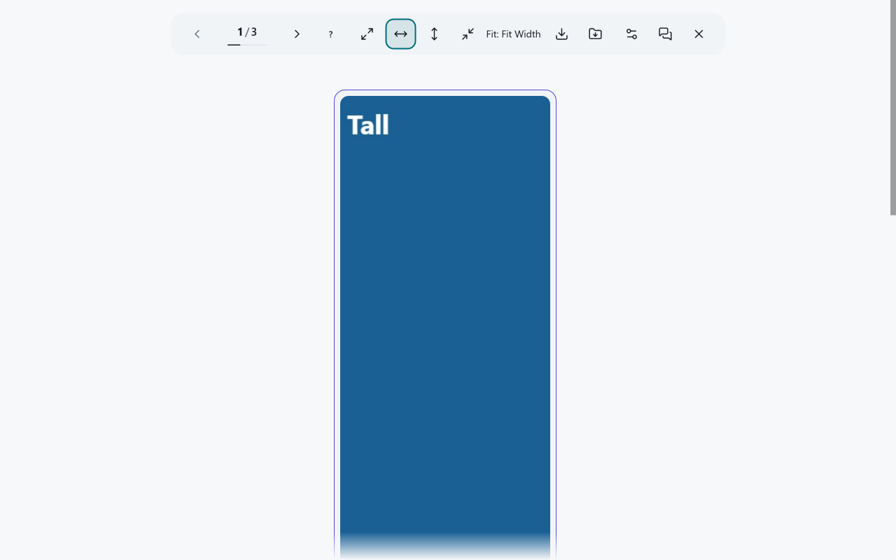
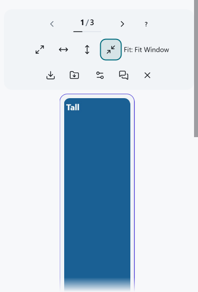

# X.com Enhanced Gallery

[English](./README.md) | [한국어](./README.ko.md) | [日本語](./README.ja.md)

Browse images and videos from an X.com post in a focused, keyboard-friendly
gallery and download supported media at its verified available quality. The
gallery is for desktop browsers.

## Choose an installation

| Distribution | Stays installed after restart? | Updates | What you need |
| --- | --- | --- | --- |
| [Userscript](#userscript) | Yes, through your userscript manager | The manager can offer updates; review and approve each offered update | A supported desktop browser and a userscript manager |
| [Chrome, Edge, or Brave extension](#chrome-edge-or-brave-extension) | Yes, while the unpacked extension and its directory remain in place | Replace the extracted files and reload the extension manually | Developer mode and a permanent directory |
| [Firefox extension](#firefox-extension) | No; the temporary add-on is removed on browser restart | Load a new ZIP manually for each session | Firefox 128+ and `about:debugging` |

The archives below are GitHub release builds; they are not public browser-store
installations. See [browser support](#browser-support) for version floors.

## Quick start

1. Open an X.com post with a supported image or video. Select an image or an
   eligible video area to open the gallery. Video clicks follow the saved
   [video-click mode](./docs/video-click-policy.md); X's player controls can
   keep their native action.
2. Move between displayed items with the toolbar's Previous/Next buttons,
   arrow keys, or wheel. In the unreleased development build, use the toolbar's
   Keyboard help (?) button or `?` for the full desktop key map.
3. Choose a display fit in the toolbar. This changes the view, not the
   [preferred save source or quality](./docs/media-sources.md).
4. Save the currently displayed item with Download, or choose Download shown
   files as ZIP for the items in this gallery. A browser handoff does not prove
   that the file finished saving on disk. If a ZIP leaves items out, read its
   result and use its offered missing-item recovery only when available; keep
   the earlier ZIP with any supplementary archive. See [download limits](#download-limits).
5. Close the gallery with Close or Escape to return to the post. When an
   original-post link is available, it opens that source post separately.

*Unreleased development build: installed Edge extension with controlled media;
1280 × 800 viewport, 100% tab zoom, 200% system DPI. [Capture details](./docs/images/README.md).*

*Unreleased development build: installed Edge extension with controlled media;
401 × 592 viewport, 100% tab zoom, 200% system DPI. [Capture details](./docs/images/README.md).*

A gallery video uses a separate paused player starting at the beginning, with
its own saved audio preferences. Closing the gallery does not automatically
resume X's player. See the [video-click and native playback policy](./docs/video-click-policy.md).

## Features

- Vertical gallery for images, videos, GIFs, and supported card media
- Verified CDN-original photo saves and supported single or ZIP downloads
- Keyboard, pointer, and wheel navigation for desktop browsers
- Original, width, height, and container image-fit modes
- Persistent theme, language, playback, and gallery settings
- No project analytics, telemetry, or developer-operated server

## Install

### Userscript

Install a userscript manager such as
[Tampermonkey](https://www.tampermonkey.net/) or
[Violentmonkey](https://violentmonkey.github.io/), then install the
[latest userscript](https://github.com/PiesP/xcom-enhanced-gallery/releases/latest/download/xcom-enhanced-gallery.user.js)
in that manager. Review and approve its installation. The manager can check
for updates through the metadata URLs in the script header; review and approve
an offered update in the manager. If an older installed copy keeps fetching a
version-pinned URL, use the [one-time repair](#older-version-pinned-userscript)
for that copy.

### Chrome, Edge, or Brave extension

The `xcom-enhanced-gallery-chrome.zip` asset on the
[latest release](https://github.com/PiesP/xcom-enhanced-gallery/releases/latest)
is an unpacked developer build. It does not update automatically.

1. Download the archive and extract it to a directory you will keep.
2. Open `chrome://extensions` and enable **Developer mode**.
3. Select **Load unpacked** and choose the extracted directory.

For a later release, replace the files in that directory and reload the
extension from `chrome://extensions`. Check saved settings after updating.

### Firefox extension

1. Download `xcom-enhanced-gallery-firefox.zip` from the
   [latest release](https://github.com/PiesP/xcom-enhanced-gallery/releases/latest).
2. Open `about:debugging#/runtime/this-firefox`.
3. Select **Load Temporary Add-on** and choose the ZIP.

Firefox removes this development installation on restart. Load it again for a
later session, or use a supported userscript manager for a persistent install.

## Troubleshooting and limits

### Older version-pinned userscript

If an installed copy has a versioned `@downloadURL`, an update check may find a
new version but still fetch the old script. Once the corrected release is
public, update that existing script once from the
[latest userscript](https://github.com/PiesP/xcom-enhanced-gallery/releases/latest/download/xcom-enhanced-gallery.user.js)
in your manager, or change its download URL through a reviewed manager
workflow. **Check for updates** alone cannot repair the pinned URL. Verify the
installed header and saved settings after the one-time update.

### Partial media and save sources

If post extraction is unavailable, a status-linked media tile may recover only
its visible, accessible media. A notice identifies that limited scope; the ZIP
contains only the items shown, which may not be every attachment in the post.
A CDN-original photo is the CDN's original-size representation, not a promise
of bytes identical to the uploader's file. An unverified original photo is not
silently saved at a smaller size. Recovered video may use an observed save
source; alternate playback does not change that choice. HLS-only attachments
need a supported MP4 source. See [media sources](./docs/media-sources.md),
[video loading](./docs/media-video-loading.md), and
[API acquisition and failures](./docs/twitter-api-contract.md).

### Download limits

Generated Blob and ZIP downloads share an in-page memory allowance. Extension
single-file saves use the browser's download manager without reserving a
whole-file page Blob. If the allowance is reached, wait for active downloads
to finish. If none are active and the limit remains, reload the page and try
fewer files at once. Wait for a browser-managed save before reloading; an
unknown native handoff does not prove completion or make a duplicate save safe.
A userscript save can retain its allowance until the page closes or reloads;
reopening the gallery does not return it. A partial ZIP result states its
included/omitted scope and failure reason. See the
[download ownership and recovery contract](./docs/download-memory.md) and
[ZIP input rules](./docs/zip-input-admission.md).

The gallery does not provide a mobile or touch flow.

## Browser support

| Distribution | Support |
| --- | --- |
| Userscript | Chrome/Edge 123+, Firefox 128+, Safari 17.5+ |
| Chromium extension | Current desktop Chrome, Edge, and Brave developer mode |
| Firefox extension | Firefox 128+ temporary developer installation |

The userscript compatibility floor is defined by `USERSCRIPT_BROWSER_SUPPORT`
in [`tooling/vite/browser-support.ts`](./tooling/vite/browser-support.ts). The
Firefox extension minimum comes from
[`extension/manifest.firefox.json`](./extension/manifest.firefox.json).

## Privacy and security

The project processes post content, author identifiers, page/media URLs and X
session authentication context for the gallery and saves. It keeps local
preferences and extension download recovery records, with no developer-operated
backend or analytics. Functional requests go to X/Twitter and its media
providers; redirects depend on the browser/manager transport. See
[Privacy](./PRIVACY.md) for recipients, storage and deletion details and
[Security](./.github/SECURITY.md) for vulnerability reports.

## Development

This project is developed with assistance from AI tools.

See [Contributing](./CONTRIBUTING.md) for setup, commands, project constraints,
and pull request expectations.

## Support

- Bugs, feature requests, and questions: [GitHub Issues](https://github.com/PiesP/xcom-enhanced-gallery/issues)
- Release history: [Changelog](./CHANGELOG.md)
- Vulnerabilities: [Security policy](./.github/SECURITY.md)

## License

MIT. See [LICENSE](./LICENSE), [NOTICE](./NOTICE.md), and the bundled
[third-party licenses](./LICENSES/).
